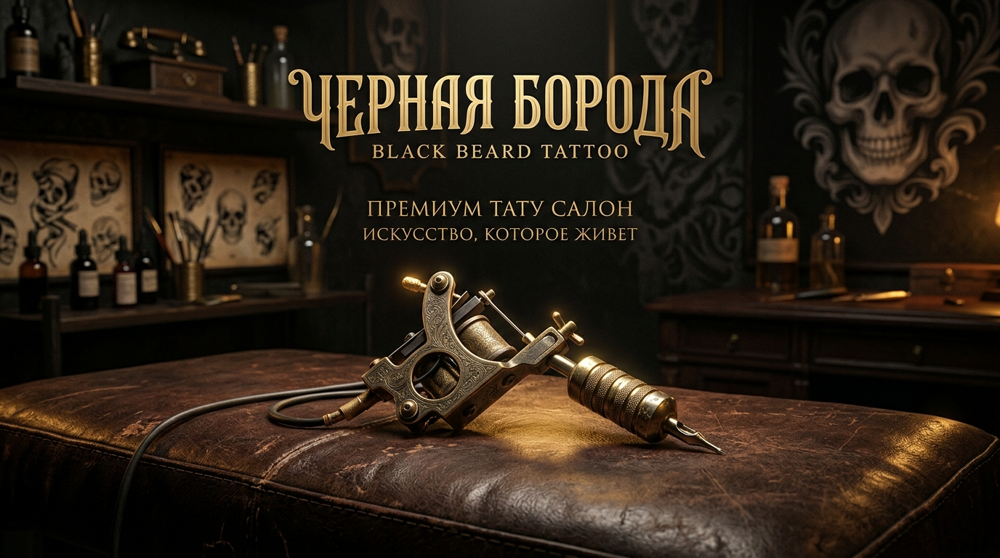

<div align="center">

  

  # ⚓ ТАТУ-САЛОН «ЧЁРНАЯ БОРОДА»
  ### *Искусство, которое живет*

  [](https://boroda-tattoo15.ru)
  [](https://vitejs.dev/)
  [](https://react.dev/)
  [](https://cloudflare.com)
  [](LICENSE)

  <br />

  🌐 **Официальный сайт:** **[boroda-tattoo15.ru](https://boroda-tattoo15.ru)**  
  📍 **Локация:** г. Владикавказ, проспект Мира, 53  
  💉 **Мастер:** Арсен  

</div>

---

## 📖 О проекте

Официальный лендинг тату-салона **«Чёрная Борода»** (Владикавказ). Проект спроектирован в брутальной темной эстетике с золотыми акцентами, подчеркивающей мастерство реализма, графики и авторских тату-работ.

### 🌟 Ключевые возможности:
- **🎨 Интерактивное портфолио:** Галерея с фильтрацией стилей и просмотром в полноэкранном Lightbox.
- **💉 Каталог услуг:** Мини-тату, масштабный реализм, надписи/леттеринг, перекрытие шрамов и старых татуировок.
- **📅 Онлайн-запись:** Модальное окно для быстрой отправки заявки и консультации.
- **⭐ Блок отзывов:** Реальные отзывы клиентов и оценки работ студии.
- **📍 Интерактивные контакты:** Адрес, график работы (11:00 – 21:00), быстрый переход в мессенджеры и соцсети.
- **🚀 SEO & OpenGraph:** Полная микроразметка Schema.org, мета-теги для красивого превью ссылок в Telegram, VK, WhatsApp.
- **📊 Готовая аналитика:** Модульная интеграция Яндекс.Метрики и Google Analytics 4.

---

## 🛠 Технологический стек

- **Фреймворк:** [React 19](https://react.dev/)
- **Сборщик:** [Vite 8](https://vitejs.dev/)
- **Иконки:** [Lucide React](https://lucide.dev/)
- **Стилизация:** Чистый CSS с переменными темы (Dark & Gold Luxury)
- **CI/CD:** [GitHub Actions](.github/workflows/deploy.yml) автодеплой на GitHub Pages
- **DNS / Домен:** [Cloudflare](https://cloudflare.com) + кастомный CNAME `boroda-tattoo15.ru`

---

## 🚀 Быстрый старт

### 1. Клонирование репозитория
```bash
git clone https://github.com/omelcukd15-coder/boroda-tattoo15.git
cd boroda-tattoo15
```

### 2. Установка зависимостей
```bash
npm install
```

### 3. Запуск локального сервера разработки
```bash
npm run dev
```
Сайт откроется по адресу `http://localhost:5173`.

### 4. Сборка продакшн-версии
```bash
npm run build
```
Готовая сборка появится в директории `dist/`.

---

## ⚙️ Настройка аналитики

В файле `index.html` уже подготовлены блоки для подключения счетчиков:

```html
<!-- Яндекс.Метрика: укажите ваш номер -->
<script>
  window.YM_ID = "12345678";
</script>

<!-- Google Analytics: укажите ваш идентификатор потока -->
<script>
  window.GA_MEASUREMENT_ID = "G-XXXXXXXXXX";
</script>
```

После изменения просто сделайте коммит и `git push` — сайт обновится автоматически!

---

## 🚢 Деплой и инфраструктура

- Репозиторий подключен к **GitHub Pages** в режиме **GitHub Actions**.
- При каждом коммите в ветку `master` запускается `.github/workflows/deploy.yml`.
- Происходит автоматическая сборка проекта и публикация на **`https://boroda-tattoo15.ru`**.

---

<div align="center">
  <sub>Разработано для тату-салона «Чёрная Борода» • 2026</sub>
</div>
